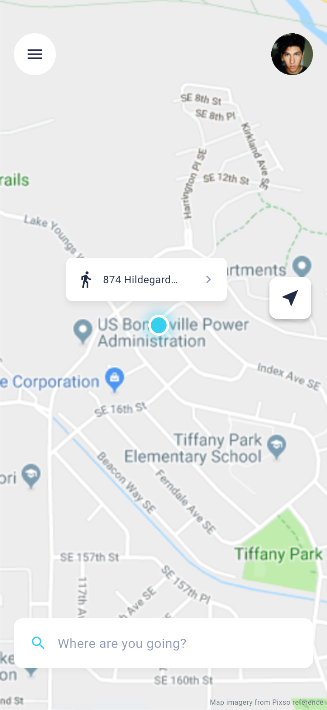
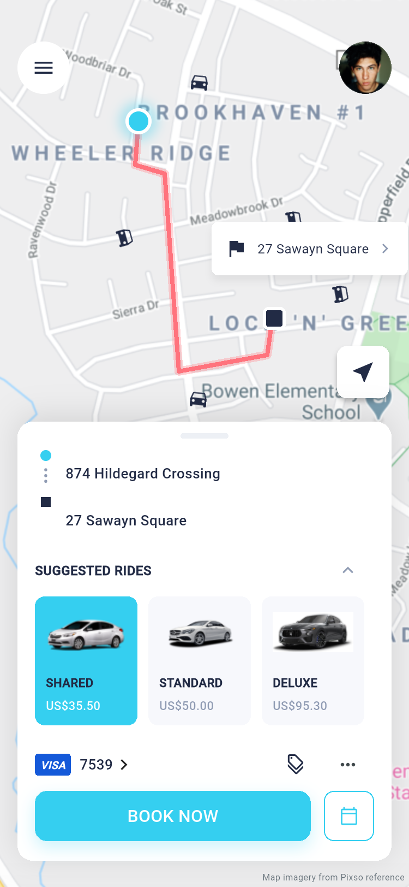
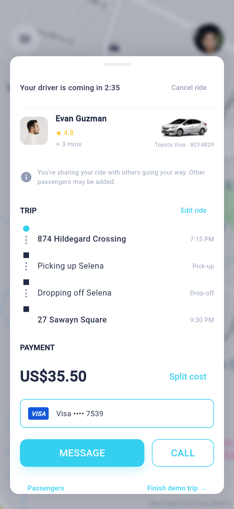
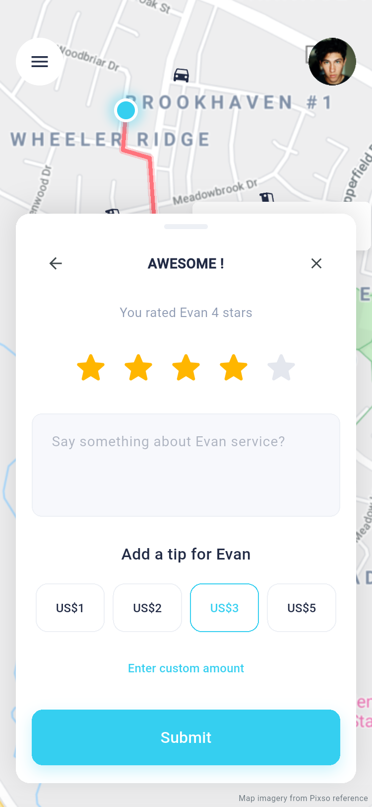
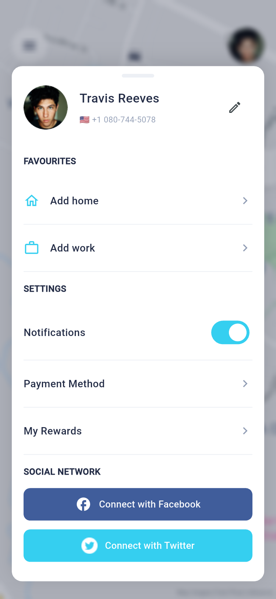

# CARGO · Car Booking & Sharing

基于 Pixso 原稿实现的 Flutter 汽车预约与拼车 App。保留原稿的英文界面、青蓝色品牌色、地图底图、车型图片、头像与定位插画；界面使用原生 Flutter Widget 构建，支持表单输入、选择与页面跳转。

本次读取的设计文件为 **CARGO - Car Booking & Sharing App**。已检查全部页面分类：文件实际只有 **👁 Components Overview（0:1）** 一个分类，包含 **30 个移动端界面**，设计尺寸均为 **375 × 812**。

## 主要界面

下面是 Android 模拟器运行 Flutter 后捕获的界面，原稿截图另存于 `docs/design-reference/`。

| 首页与地址入口 | 车型选择与预约 | 司机接驾与支付 |
| --- | --- | --- |
|  |  |  |

| 注册账户 | 行程评价与小费 | 个人中心 |
| --- | --- | --- |
|  |  |  |

- [30 页实现、原稿节点和截图对应表](docs/页面清单.md)
- [30 页运行截图总览](docs/screenshots/overview-01.jpg)、[预订支付部分](docs/screenshots/overview-11.jpg)、[行程和账户部分](docs/screenshots/overview-21.jpg)
- [验证记录与限制](docs/测试报告.md)

## 功能与演示路径

1. 启动页 → 注册 → 手机验证码 → 定位引导 → 首页。也可直接输入邮箱和密码登录。
2. 首页 → 目的地搜索／收藏地点／地图选点 → 选择车型。
3. 选择支付方式、添加演示信用卡、使用优惠券、选择预约时间 → BOOK NOW。
4. 订单处理中点击 **Track driver** → 司机接驾 → 展开乘客或支付明细。
5. **Finish demo trip →** → 星级评价 → 填写反馈与小费 → Submit → 已完成行程。
6. 取消行程会生成 US$2 的本地演示取消记录；已完成行程记录包含车费与小费。

邮箱需符合基本格式，密码至少 6 位，手机号至少 6 位数字。演示验证码为 **3247**，优惠码为 **CARGO10**。信用卡演示可使用 `4111111111111111`、有效期 `12/2099`、CVV `123`；仅保存末四位。

可长按启动页 Cargo 标识，或从侧边菜单 **All 30 screens** 打开页面预览列表。车型面板上的省略号也可打开同一入口。列表包含原稿中的输入状态、展开面板和弹窗状态，方便独立核对。

## 运行与构建

开发验证环境：Flutter **3.41.6**、Dart **3.11.4**。工程要求 Dart `^3.11.0`；包含 Android、iOS、Web 平台目录。

```sh
flutter pub get
flutter run -d emulator-5554
```

如果没有启动 Android 模拟器，先通过 Android Studio Device Manager 启动设备，运行 `flutter devices` 确认 ID 后替换命令中的设备 ID。

```sh
# 浏览器预览
flutter run -d chrome

# 从指定界面启动：9 = Home，14 = Select Service
flutter run -d emulator-5554 --dart-define=SCREEN=14

# Android ARM64 安装包
flutter build apk --release --target-platform android-arm64
```

Web 也可使用 `?screen=14` 进入指定页面。编号范围为 1–30，完整编号见页面清单。移动端保持原稿比例和布局，大屏以最大 480 逻辑像素宽度居中展示。

已准备的安装包：[`dist/cargo-android-arm64.apk`](dist/cargo-android-arm64.apk)。这是使用开发签名的本地测试包，适合 Android ARM64 设备和本次模拟器；正式分发前应配置自己的签名。

## 项目结构

```text
CARGO-CarBooking&Sharing/
├── lib/
│   ├── main.dart                       # 应用启动、主题、30 页入口映射
│   ├── core/
│   │   ├── app_state.dart              # 页面枚举、导航历史、车型与本地业务状态
│   │   └── ui.dart                     # 色彩、按钮、表单、列表、头像、页面预览
│   └── features/
│       ├── auth/auth_pages.dart        # 启动、登录注册、国家、验证、定位
│       ├── booking/
│       │   ├── map_view.dart           # 地图图层、路径绘制、浮动面板、行程路线
│       │   ├── booking_pages.dart      # 首页、目的地、收藏、车型选择
│       │   └── trip_pages.dart         # 匹配、接驾、取消、评价、小费
│       ├── payment/payment_pages.dart  # 优惠、支付、卡片录入、扫描预览、预约
│       └── account/account_pages.dart  # 侧边菜单、个人资料、行程历史
├── assets/
│   ├── images/                        # 从 Pixso 导出的原始图片与插画
│   └── fonts/                         # Roboto 字体和 Apache 2.0 授权
├── test/widget_test.dart              # 布局、交互、校验与状态测试
├── integration_test/screenshots_test.dart
├── test_driver/screenshots.dart       # 将模拟器截图保存到 docs/screenshots
├── tool/make_gallery.py               # 生成截图总览和页面索引
├── docs/
│   ├── design-reference/              # 30 张 Pixso 原稿截图和来源索引
│   ├── screenshots/                   # 30 张 Flutter 运行截图和总览
│   ├── verification/                  # 检查和测试结果日志
│   ├── 页面清单.md
│   └── 测试报告.md
├── dist/cargo-android-arm64.apk
├── android/                           # Android 宿主
├── ios/                               # iOS 宿主
├── web/                               # Web 宿主
└── pubspec.yaml
```

## 架构与状态流

采用 **按功能分组的 UI + 单一状态控制器**。当前规模没有引入网络层、数据库或额外状态管理依赖。

```text
用户输入／点击
       ↓
Feature Widgets（auth / booking / payment / account）
       ↓
AppState（ChangeNotifier）
  ├─ AppPage + 导航历史
  ├─ 目的地、收藏地址、车型、支付方式、优惠与预约时间
  └─ 下单、取消、完成、行程记录
       ↓ notifyListeners()
AppScope（InheritedNotifier）+ AnimatedBuilder
       ↓
当前页面读取一致状态并更新界面
```

`AppState` 负责跨页状态和业务动作，局部表单输入、搜索关键字和页签由页面自身维护。`PageShell`、`SheetPanel`、`TripRoute`、`PrimaryButton` 等共用组件统一版式。地图底图使用设计素材，路线由 `CustomPainter` 绘制，浮动面板保持可滚动，避免窄屏遮挡。

`services` 定义五档车型与价格；优惠分别按 10%、30% 和 US$5 计算。`book()`、`cancelRide()`、`completeRide()` 统一处理订单生命周期。支付方式返回入口会保留调用页面；国家选择返回时保留已输入的注册信息。

接入实际业务时，可将 `AppState` 中的数据访问与动作移至 repository/service，分别接入账户、地图定位、订单、支付及本地持久化服务；页面可以继续使用现有组件和模型。

## 复现检查与截图

```sh
flutter analyze
flutter test
flutter drive \
  --driver=test_driver/screenshots.dart \
  --target=integration_test/screenshots_test.dart \
  -d emulator-5554

# 可选：更新总览与 Markdown 索引，需要 Pillow
python3 tool/make_gallery.py
```

截图测试依次进入 30 个页面，检查 Flutter 异常并保存 PNG，然后实际点击执行首页搜索目的地、叫车、查看司机的流程。截图来自 Flutter 渲染表面，保留 App 内容，不包含 Android 状态栏、系统导航栏或系统键盘。输入状态页面仍可唤起设备原生键盘。

## 实现范围与差异

本版本为 **可运行、可交互的本地 UI 演示 App**：未连接后端、真实地图 SDK、实时定位、短信、OAuth、相机识卡、司机消息、拨号或支付网关。界面中的演示动作不会发送消息、发起通话或扣费；所有状态只保存在当前进程，重启后恢复初始数据。

原稿没有提供字体文件，因此使用随项目打包的 Roboto 保证跨平台一致；字形与 SF UI Display 存在差异。Android 使用原生键盘、日期选择器和系统返回行为；订单匹配与结束增加了演示控制入口，便于完整体验流程。国家列表是可搜索的演示子集，正式产品需接入完整国家/地区数据。

已移除 Pixso 自动导出的重复图层代码、无效资源链接、无用素材和 Flutter 计数器模板；运行时仅依赖 Flutter SDK。保留功能分层和共用组件，方便继续开发。
